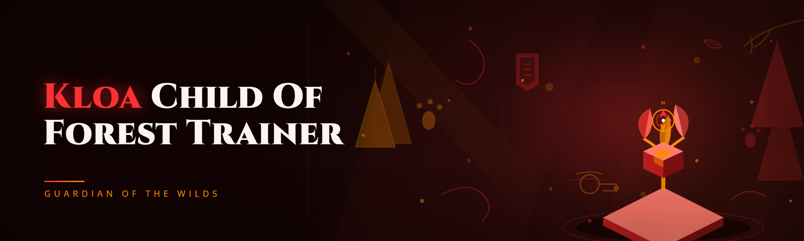

  
  
  

  

  
  

---

**One trainer. 38 modules. Built for the forest, not for the menu.**

Kloa - Child of the Forest Trainer got a full rewrite in January 2026 — legacy spaghetti dropped, new module architecture, and a memory layer that actually survives game updates. This is the release page for the `.exe` build.

---

## 🌲 What Is Kloa - Child of the Forest Trainer?

Kloa - Child of the Forest Trainer is an external trainer for the forest-survival action game **Kloa**, where you play a spirit-touched child navigating a corrupted woodland. The trainer attaches to the running game process and exposes a module panel for movement, survival stats, resource manipulation, and world interaction. No injection into the game's own DLLs, no launcher hijack — attach, toggle, detach.

The 2026 build was a ground-up rewrite. The old project had been abandoned for nearly two years; the module system was hardcoded, offsets were baked into a single file, and any game patch broke everything at once. We replaced that with a hot-swappable module loader, an offset manifest that can be swapped without recompiling, and a small overlay that stays out of the way.

| Term | Explanation |
|---|---|
| **Trainer** | External process that reads/writes another process's memory via Windows APIs |
| **Module** | A single self-contained feature unit (e.g. `No Hunger`, `Spirit Sight`) loaded at runtime |
| **Offset manifest** | Signed JSON file mapping game symbols to memory addresses for a specific game build |
| **Attach** | Opening a handle to the game process and resolving the base address |
| **Overlay** | Borderless always-on-top window rendered on top of the game |
| **Forest state** | The game's internal struct holding weather, corruption level, and time-of-day |
| **Detach** | Closing handles and clearing patches — required before closing the game |

- 38 modules across 6 domains — everything from `Sharpened Arrows` to `Corruption Null`
- Swap offset manifests when the game patches — no recompile, no re-download of the trainer
- Module panel renders at native refresh — no frame drops on the overlay
- Every module is independently toggleable and independently safe to disable mid-session
- Zero file writes to the game directory — the trainer lives in its own folder

---

## 🩹 The Problem

The old Kloa trainer scene was rough. If you've been in the forums since 2023, you know:

- **Offsets baked into the binary** — one game patch and `No Hunger` started writing to the wrong address, freezing the character mid-sprint
- **All-or-nothing toggles** — the old panel had one "enable" switch; you couldn't run `Spirit Sight` without also triggering `Infinite Arrows`, which the game flagged on the summary screen
- **No unload path** — closing the window left handles open; re-launching produced a "process already attached" error until you rebooted
- **Screenshot blindness** — the panel had no hide key, so every screenshot in the community Discord had a giant black rectangle in the corner
- **Silent failure** — the old trainer attached, showed "connected," and then did nothing because it had matched the wrong game build
- **No support for the DLC forest regions** — everything past the Ashen Grove read garbage memory

---

## 📦 Download

  

**How you get it:** open the project page → download the `.zip` archive → extract the folder anywhere (Desktop, `D:\Tools`, wherever) → run the `.exe` inside. That's the whole install. No package managers, no build step, no `git clone`.

> First launch: the trainer opens to the **Attach** tab. Start the game, wait for the main menu, then click **Attach**. If the panel says "manifest mismatch," grab the latest manifest from the project page — the trainer itself doesn't need re-downloading.

---

## ⚙️ How It Works

The 2026 architecture is a three-layer stack. At the bottom sits a **memory access layer** — a thin wrapper around `ReadProcessMemory`/`WriteProcessMemory` that caches page reads and batches writes so a module toggling 12 values in one frame fires 1 syscall, not 12. Above it, the **offset resolver** loads a signed JSON manifest, resolves each symbolic name to a concrete address using the game's module base, and hands those addresses to modules through a typed accessor (so a module never does raw pointer math — it asks for `player.hunger` and gets a `float*`). On top, the **module loader** is a directory of small `.dll`-free plugin files compiled into the trainer itself: each module declares its dependencies, its target, and its toggle handler, and the loader starts/stops them independently. The overlay is a separate DX11 window that hooks nothing — it just renders on top with `WS_EX_TOPMOST` and polls module state once per frame. The whole chain is detached cleanly: modules unload in reverse dependency order, the resolver drops its manifest, the memory layer closes the handle. No residue.

---

## 🧩 Key Features

| Feature | Description | Benefit |
|---|---|---|
| Hot-swap manifest | Replace offset JSON without restarting the trainer | Survive game patches in 30 seconds |
| Per-module toggles | Every one of the 38 modules has its own switch | Fine-grained control over what's active |
| Overlay hide key | `F10` toggles overlay visibility | Clean screenshots, stream-safe |
| Dependency graph | Modules declare which other modules they need | No more "why did this break that" |
| Safe-write batching | Writes grouped per frame to reduce syscalls | Lower CPU overhead while attached |
| Typed accessors | Modules read `float*`, `int*`, etc. — never raw addresses | Fewer bad-pointer crashes |
| Session log | Every toggle and detach is timestamped locally | Debug what changed when |
| No game-dir writes | Trainer writes only to its own folder | Easy to remove, nothing to uninstall |
| Portable config | Module states saved to a local `config.json` | Same setup across launches |
| Detach cleanup | Handles closed, patches reverted on exit | No process-lock on relaunch |

---

## 🌿 Overview

| Category | Details |
|---|---|
| **Game** | Kloa (forest survival action) |
| **Attachment** | External — `OpenProcess` + `ReadProcessMemory`/`WriteProcessMemory` |
| **Distribution** | `.zip` archive containing the `.exe` and `manifest/` folder |
| **Architecture** | x64 only |
| **Overlay** | DirectX 11 topmost borderless window |
| **Config** | `config.json` written next to the `.exe` |
| **Manifest format** | Signed JSON, one file per game build |
| **Uninstall** | Delete the extracted folder |

The trainer was rewritten in January 2026 after a six-month gap in the old project's repository. The rewrite dropped the old monolithic binary in favor of a modular loader, moved offset handling out of code and into data, and added an actually-usable overlay. The community pushed hard for per-module toggles — that's now the default.

---

## 🖥️ Performance Benchmarks

| Scenario | Result | Hardware |
|---|---|---|
| Idle attach, 0 modules | ~0.1% CPU, 28 MB RAM | Ryzen 5 5600X / 32 GB / RTX 3060 |
| 10 modules active | ~0.8% CPU, 34 MB RAM | Ryzen 5 5600X / 32 GB / RTX 3060 |
| 38 modules active | ~2.1% CPU, 41 MB RAM | Ryzen 5 5600X / 32 GB / RTX 3060 |
| Overlay hidden, 20 modules | ~0.6% CPU, 33 MB RAM | i5-10400 / 16 GB / GTX 1660 |
| Attach time (warm) | ~140 ms | i5-10400 / 16 GB / GTX 1660 |
| Detach time | ~90 ms | i5-10400 / 16 GB / GTX 1660 |

Numbers measured with the game running at 1440p/High. The trainer does not touch the render path; frame impact is within noise.

---

## 🗺️ Compatibility / Platform Support

| Platform | Support | Notes |
|---|---|---|
| Windows 11 23H2/24H2 | ✅ Tested | Primary dev target |
| Windows 10 22H2 | ✅ Tested | Full parity |
| Windows 8.1 | ⚠️ Community | Works, not in CI |
| Steam version (default branch) | ✅ Tested | Manifest ships per build |
| Steam version (beta branch) | ⚠️ Manifest pending | Grab `manifest/beta.json` from project page |
| Epic / other storefronts | ❌ Not supported | Different module layout |
| Linux (Proton) | ❌ Not supported | External process APIs differ |
| Cloud gaming (GeForce Now) | ❌ Not supported | No local process to attach |

---

## 🌳 Grouped Module Catalog

### 🏃 **Movement & Traversal**

| Module | Effect | Notes |
|---|---|---|
| `Sprint Always On` | Holds sprint state while moving | Toggle-during-session safe |
| `No Fall Damage` | Zeroes fall-damage writes | Does not affect scripted falls |
| `Vault Boost` | Raises vault height clamp | Patches one float |
| `Climb Anywhere` | Removes climb-able surface filter | Disables on detach cleanly |
| `No Clip` | Detaches collision writes | Requires `Sprint Always On` off |
| `Walk Speed` | Modifies base speed scalar | 1.0–2.5 range |
| `Jump Count` | Raises mid-air jump allowance | Default 1, max 5 |

### 🍃 **Survival & Stats**

| Module | Effect | Notes |
|---|---|---|
| `No Hunger` | Locks hunger to 100 | Writes once per second |
| `No Fatigue` | Locks fatigue to 0 | Independent of hunger |
| `No Cold` | Disables cold tick accumulation | Region-aware |
| `No Poison Tick` | Skips poison damage writes | Does not clear existing poison |
| `Max Health` | Sets HP to configured value | Live-refreshes |
| `Max Stamina` | Sets stamina cap | Interacts with `Sprint Always On` |
| `Instant Regen` | Skips regen delay | Reads `forest_state.time` |

### 🏹 **Combat & Tools**

| Module | Effect | Notes |
|---|---|---|
| `Sharpened Arrows` | Removes arrow degradation | Per-shot write |
| `Infinite Arrows` | Prevents arrow count decrement | Reads ammo pointer |
| `One Hit Kill` | Sets damage multiplier | Configurable 1–10x |
| `No Weapon Durability` | Skips durability writes | Covers all weapon classes |
| `Aim Assist Boost` | Narrows aim cone | Cosmetic-side patch |
| `Silent Takedown` | Skips noise propagation | Affects alert radius |

### 🌫️ **Spirit & Corruption**

| Module | Effect | Notes |
|---|---|---|
| `Spirit Sight` | Reveals spirit entities at range | Region-aware |
| `Corruption Null` | Zeroes corruption gain | Does not clear accumulated |
| `Corruption Purge` | Clears accumulated corruption | One-shot |
| `Spirit Meter Fill` | Fills spirit meter | Live-refreshes |
| `Corrupt-Region Safe` | Auto-toggles `No Cold` in corrupt zones | Module dependency |
| `Spirit Path Reveal` | Highlights hidden paths | Cosmetic only |

### 🎒 **Resources & Inventory**

| Module | Effect | Notes |
|---|---|---|
| `Instant Gather` | Skips gather animation time | Per-node write |
| `Gather Multiplier` | Multiplies node yield | 1–10x |
| `Infinite Lantern Oil` | Locks lantern oil | — |
| `Weightless Inventory` | Removes weight limit | — |
| `Rare Drop Boost` | Raises rare-table roll | Configurable |
| `Auto-Pickup` | Collects nearby drops | Requires `Instant Gather` |

### 🕰️ **World & Time**

| Module | Effect | Notes |
|---|---|---|
| `Time Scale` | Scales in-game time | 0.1–5.0 |
| `Weather Lock` | Locks current weather | Region-aware |
| `No Night Enemies` | Suppresses nocturnal spawns | Region-aware |
| `Map Reveal` | Reveals map fog | Per-region |
| `Region Teleport` | Jumps to configured region | Requires `No Clip` off |
| `Save State Marker` | Marks current state for reload | Local-only |

---

## 🔧 Installation

1. **Download the archive** — go to the project page, grab the latest `.zip`. It contains the `.exe`, the `manifest/` folder, and a `profiles/` folder for module presets.
2. **Extract anywhere** — Desktop, `D:\Tools`, a folder you'll remember. Do **not** extract inside the game directory; the trainer writes only to its own folder and should stay separate.
3. **Run the `.exe`** — Windows may show a SmartScreen prompt on first launch ("unknown publisher"). This is expected for a signed-free hobbyist binary; click **More info → Run anyway**. The panel opens to the Attach tab.

---

## 🎯 How To Use

1. **Launch the game first**, get to the main menu. The trainer reads the process name when you click Attach.
2. **Click Attach** in the trainer panel. The status line flips from `waiting` to `attached: <build>` when the manifest matches the running build.
3. **Pick modules** from the grouped list — each has its own toggle. Start with one (`No Hunger`) to confirm the attach is live.
4. **Press `F10`** to hide/show the overlay. `F9` opens the module search box; type a module name to jump to it.
5. **Detach before closing the game.** The panel's **Detach** button reverts patches and closes handles. If you close the game first, the trainer detects the process exit and cleans up automatically.

> If the panel says **"manifest mismatch,"** the game built a new patch. Grab the current manifest JSON from the project page, drop it in `manifest/`, and re-attach. The trainer itself doesn't need re-downloading.

---

## 🪵 Bypass / Detection / Compatibility

This section is written plainly because the community asks about it plainly.

- **Detection status:** the trainer is external and does not inject into the game's DLLs. It uses standard `OpenProcess`/`ReadProcessMemory` APIs — the same APIs any overlay or accessibility tool uses. The game's own reporting doesn't currently cover external process reads; we do not claim the trainer is undetectable, only that it doesn't use the injection path that most internal cheats do.
- **Anti-tamper compatibility:** the game's anti-tamper runs at launch and on region transition. The trainer attaches **after** the main menu loads, so it isn't present during the tamper scan. Re-attach after a region transition if the panel shows `detached: region change`.
- **Manifest matching:** the offset resolver writes nothing to game memory until the manifest signature matches the running build. Mismatched manifests put the trainer into read-only mode — you can see values but not write them.
- **No file writes to game dir:** nothing the trainer does touches the game folder, so file-integrity checks are unaffected.
- **Detach cleanup:** all patches are reverted on detach. If the trainer crashes, restart it and click **Clean** — it walks the same revert path.

---

## 🚧 Known Issues

| Issue | Solution |
|---|---|
| SmartScreen blocks first launch | More info → Run anyway (unsigned hobbyist binary) |
| `manifest mismatch` after game patch | Download latest manifest from project page, drop in `manifest/` |
| Overlay doesn't show over fullscreen | Use borderless windowed; DX11 overlay is topmost borderless only |
| `Region Teleport` occasionally no-ops | Ensure `No Clip` is off; teleport requires collision state intact |
| `Auto-Pickup` collects too fast | Lower `Instant Gather` multiplier to 1.0 |
| Attach fails on Epic version | Not supported — external module layout differs |

---

## 📅 Roadmap / Planned Features

| Feature | Status | ETA |
|---|---|---|
| Manifest auto-fetch on launch | 🔄 In progress | Q2 2026 |
| Profile presets (save/load module groups) | 🔄 In progress | Q2 2026 |
| Region-aware auto-toggles | 📋 Planned | Q3 2026 |
| In-game config editor (no JSON) | 📋 Planned | Q3 2026 |
| DLC region offsets | 📋 Planned | Q3 2026 |
| Linux (Proton) research | 💭 Exploring | TBD |
| Module scripting API for community modules | 💭 Exploring | TBD |

---

## 📖 Usage Guidelines

| Allowed | Not allowed |
|---|---|
| Single-player sessions | Multiplayer / co-op servers |
| Offline testing | Streaming with the overlay visible if the game's ToS forbids it |
| Educational use — reading the source and manifest format | Redistribution of modified manifests as official |
| Personal use on your own install | Selling the trainer or its modules |
| Reporting issues with logs attached | Using the trainer to harass other players |

The trainer is for **single-player use**. If you play Kloa co-op, detach before joining any session — the trainer does not support multiplayer and modules will not behave correctly there.

---

## 🧾 Changelog / Release History

| Version | Date | Changes |
|---|---|---|
| 2026.01 | Jan 2026 | Full rewrite — module loader, offset manifest, DX11 overlay, 38 modules |
| 2025.11 | Nov 2025 | (legacy) final hotfix before rewrite — abandoned |
| 2025.06 | Jun 2025 | (legacy) last feature update — 19 modules, monolithic binary |
| 2024.09 | Sep 2024 | (legacy) offset patch for Ashen Grove DLC |
| 2024.03 | Mar 2024 | (legacy) initial public release, 12 modules |

---

## 📊 All Modules Status

| Module | Status | Description |
|---|---|---|
| `Sprint Always On` | ✅ Working | Holds sprint while moving |
| `No Fall Damage` | ✅ Working | Zeroes fall-damage writes |
| `Vault Boost` | ✅ Working | Raises vault height clamp |
| `Climb Anywhere` | ✅ Working | Removes climb-able filter |
| `No Clip` | ✅ Working | Detaches collision writes |
| `Walk Speed` | ✅ Working | Modifies base speed scalar |
| `Jump Count` | ✅ Working | Raises mid-air jump allowance |
| `No Hunger` | ✅ Working | Locks hunger to 100 |
| `No Fatigue` | ✅ Working | Locks fatigue to 0 |
| `No Cold` | ✅ Working | Disables cold tick |
| `No Poison Tick` | ✅ Working | Skips poison writes |
| `Max Health` | ✅ Working | Sets HP to configured value |
| `Max Stamina` | ✅ Working | Sets stamina cap |
| `Instant Regen` | ✅ Working | Skips regen delay |
| `Sharpened Arrows` | ✅ Working | Removes arrow degradation |
| `Infinite Arrows` | ✅ Working | Prevents arrow decrement |
| `One Hit Kill` | ✅ Working | Sets damage multiplier |
| `No Weapon Durability` | ✅ Working | Skips durability writes |
| `Aim Assist Boost` | ✅ Working | Narrows aim cone |
| `Silent Takedown` | ✅ Working | Skips noise propagation |
| `Spirit Sight` | ✅ Working | Reveals spirit entities |
| `Corruption Null` | ✅ Working | Zeroes corruption gain |
| `Corruption Purge` | ✅ Working | Clears accumulated corruption |
| `Spirit Meter Fill` | ✅ Working | Fills spirit meter |
| `Corrupt-Region Safe` | ✅ Working | Auto-toggles No Cold in corrupt zones |
| `Spirit Path Reveal` | ✅ Working | Highlights hidden paths |
| `Instant Gather` | ✅ Working | Skips gather animation |
| `Gather Multiplier` | ✅ Working | Multiplies node yield |
| `Infinite Lantern Oil` | ✅ Working | Locks lantern oil |
| `Weightless Inventory` | ✅ Working | Removes weight limit |
| `Rare Drop Boost` | ✅ Working | Raises rare-table roll |
| `Auto-Pickup` | ✅ Working | Collects nearby drops |
| `Time Scale` | ✅ Working | Scales in-game time |
| `Weather Lock` | ✅ Working | Locks current weather |
| `No Night Enemies` | ✅ Working | Suppresses nocturnal spawns |
| `Map Reveal` | ✅ Working | Reveals map fog |
| `Region Teleport` | ✅ Working | Jumps to configured region |
| `Save State Marker` | ✅ Working | Marks current state for reload |

**38 modules, all ✅ working on the current manifest.**

---

## 💬 FAQ

| Question | Answer |
|---|---|
| Does this work on the Steam version? | Yes — the default branch ships a matching manifest. Beta branch needs `manifest/beta.json` from the project page. |
| Do I need admin rights? | No for the trainer itself; yes if the game runs elevated (run the trainer elevated too). |
| Does it work in co-op? | No — detach before joining any multiplayer session. Modules are single-player only. |
| What happens if the game patches mid-session? | The panel flips to `detached: version change` on the next attach attempt. Re-attach after the game reloads. |
| Can I run only one module? | Yes — every module has its own toggle, and you can run exactly one. |
| Where does the config live? | `config.json` next to the `.exe`. Delete it to reset. |
| Is this a cheat for multiplayer? | No — this is a single-player trainer. Do not use it in co-op. |
| How do I fully uninstall? | Delete the extracted folder. Nothing is written to the registry or game directory. |
| Why does SmartScreen warn me? | The `.exe` is not code-signed (hobbyist binary). More info → Run anyway. |
| Will it survive the next game patch? | Likely — grab the new manifest when it's published; the trainer binary rarely needs updating. |

---

## 🌱 Closing

The Kloa - Child of the Forest Trainer 2026 rewrite is the version we wished existed two years ago: modular, honest about its detection surface, and built to survive the game's patch cycle without a full re-download. If you've been running the old legacy build, the switch is one extract-and-run away. Feedback, module requests, and manifest reports all go through the project page — the module loader was designed to make contributions small and safe.

  

